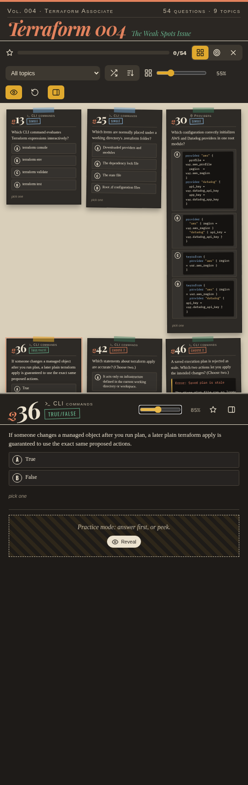
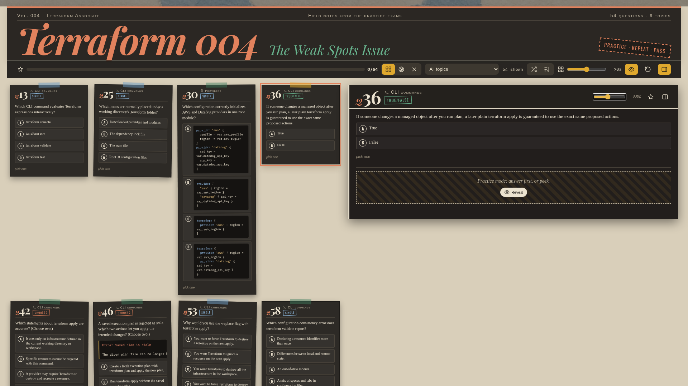

Practice dashboard of 54 questions Johan keeps getting wrong, laid out as a card grid with a collapsible right-hand explanation panel (answer, explanation, why the others are wrong, and a simulated terminal run) and a practice mode that tracks mastered and wrong counts in localStorage. Open `index.html` in a browser; no build or network is needed.

Double-click a card to copy the question, exhibit, and options as plain text.

The page has a favicon. A successful double-click copy shows a green "✓ Copied" badge plus toast, and a failed copy shows a red badge plus toast.

The explanation panel always takes half the page: half the width on wide screens, and half the height as a bottom sheet on narrow ones. Smooth sliders set card size (40–100%) and panel text size (50–130%), and both are remembered in localStorage.

The explanation panel no longer repeats the question: it shows a compact header, a green answer line, then the explanation. The selected card shows an "IN PANEL" tag with a glow.

The panel has Explain and Simulate tabs. Simulate is a step-by-step terminal simulation for every question. The chosen tab is remembered, and E/S or the arrow keys switch tabs while focus is in the panel.

