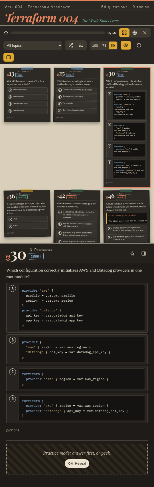
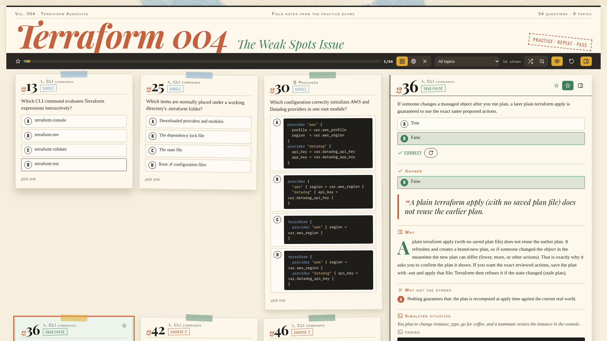
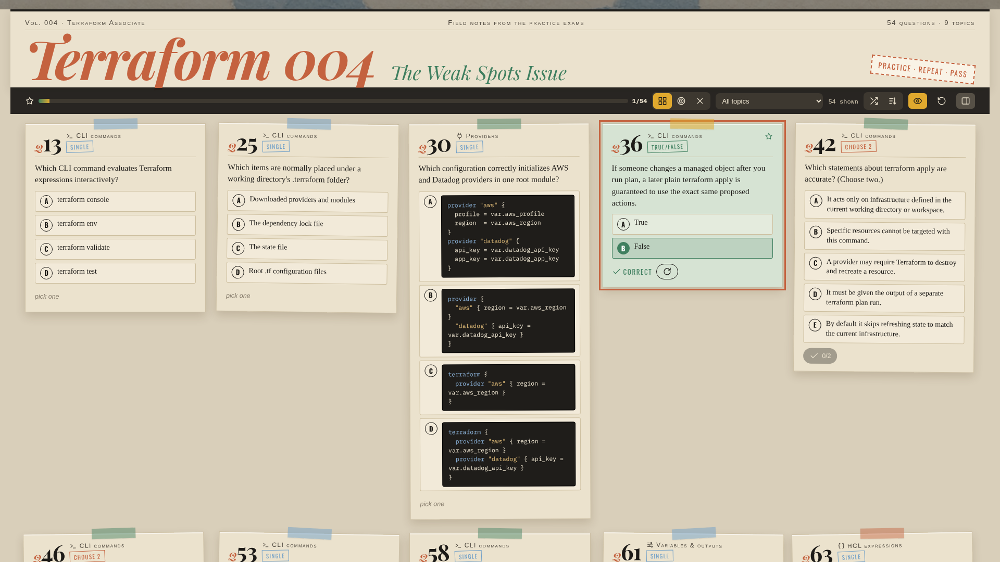
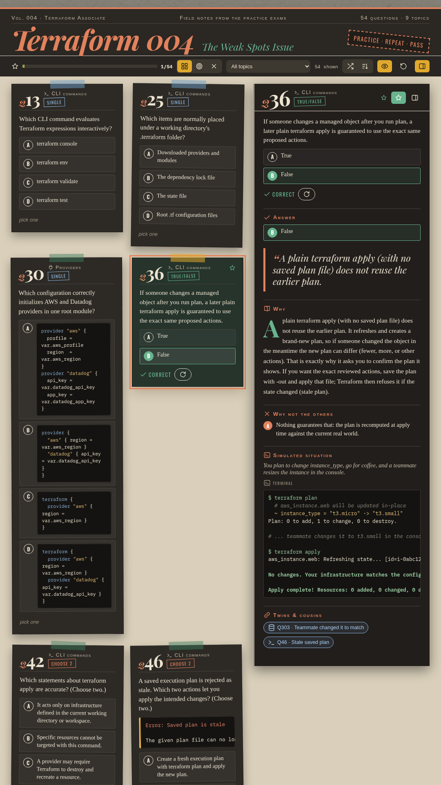

Practice dashboard of 54 questions Johan keeps getting wrong, laid out as a card grid with a collapsible right-hand explanation panel (answer, explanation, why the others are wrong, and a simulated terminal run) and a practice mode that tracks mastered and wrong counts in localStorage. Open `index.html` in a browser; no build or network is needed.

Double-click a card to copy the question, exhibit, and options as plain text; a "Qn copied" toast confirms the copy.

The top bar has a card size switch (100 / 75 / 50%), remembered in localStorage, so more cards fit in a narrow browser side panel.

